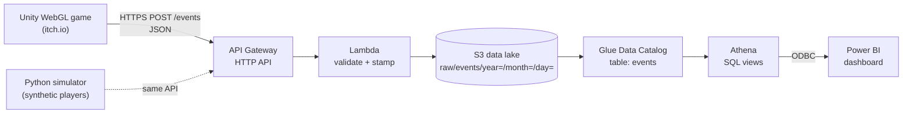

# Rocket Booster Telemetry

**A browser game that sends gameplay telemetry to a serverless AWS data pipeline, modeled in Athena and analyzed in Power BI.**

🎮 **Play it:** [primus7274.itch.io/rocket-booster](https://primus7274.itch.io/rocket-booster)

Every crash, fuel pickup and level completion becomes a JSON event. The events travel through API Gateway and Lambda into a partitioned S3 data lake, get catalogued by Glue, modeled with SQL views in Athena, and turned into level-design and retention insights in a Power BI dashboard.

I built this end to end while preparing for the **AWS Certified Data Engineer – Associate** exam. The game started as a Unity course project; the telemetry, the AWS pipeline, the data model and the dashboard are my own work.

---

## Architecture



| Layer | Service | Key settings |
|---|---|---|
| Ingestion | API Gateway (HTTP API) | `POST /events`, throttling 10 req/s (burst 20), CORS restricted to the game's origin |
| Validation | Lambda (Python 3.13) | Rejects invalid JSON, missing fields and unknown event types (HTTP 400); adds `received_at` |
| Storage | S3 | Block Public Access, SSE-S3 encryption, Hive-style partitions by arrival date |
| Catalog | Glue Data Catalog | Table `events`; **partition projection**, so new days appear without crawlers or `MSCK REPAIR` |
| Modeling | Athena | Four SQL views (event, attempt, session and player grain) |
| BI | Power BI Desktop | Athena ODBC driver, Import mode, two report pages |

**Security choices:** the game holds no AWS credentials, only a public endpoint URL. The Lambda role can only `s3:PutObject` under `raw/*` (least privilege). The endpoint is protected by throttling, input validation, a CORS allow-list and a monthly AWS Budget alert.

---

## Business questions

The dashboard answers the questions a game studio would ask about its levels and players:

1. **Which level is too hard?** Completion rate per attempt and per player, and how attempts end (completed, crashed, abandoned)
2. **Where do players drop off?** A funnel of players reaching each level
3. **Is fuel the problem, or the obstacles?** Fuel-starvation rate per level
4. **Do players come back?** Day-1 and 7-day retention, by skill band and by whether they beat the game

### Dashboard


### Findings

> ⚠️ **Most of this data is synthetic.** Of the 103 players, 100 are simulated (`sim-` IDs, 2,640 events from a Python simulator used to test the pipeline at scale); the other 3 are my own test sessions in the editor, a local build and the live itch.io page. The results below mainly show that the pipeline and metrics work; the dashboard's `player_type` filter separates real from simulated players.

- **`Under` is the problem level:** only 27.2% of its attempts succeed and 62.8% crash. It also has the highest abandon rate (10.0%) and the longest median winning run (22.7 s).
- **Fuel is a big part of why:** 29.2% of attempts on `Under` run the tank dry, against 9.8% on `Over` and 11.7% on `Through`. Adding a fuel pickup would likely help more than moving obstacles.
- **A third of players never reach the end:** 103 players start, 88 reach `Under`, and only 70 (68%) reach the final level.
- **The last level is the easiest** (42.6% completion), which suggests reordering levels so difficulty ramps up.
- **Beating the game is the strongest retention signal:** 59% of players who beat it returned within 7 days, against 18% of those who didn't.
- **Not every gap is real:** Medium-skill players retained better than High (59% vs 48%), but each group has only ~25–35 players, so that difference is within noise.

---

## Data model

### Events

| Field | Description |
|---|---|
| `event_id` | GUID, unique per event |
| `event_type` | `session_started`, `level_started`, `player_crashed`, `level_completed`, `fuel_collected`, `fuel_empty` |
| `player_id` | Random anonymous ID, stored on the player's device |
| `session_id` | New for each game launch |
| `level_id` | Scene name (`Over`, `Under`, `Through`) |
| `event_timestamp` | When it happened in the game (UTC) |
| `game_version` | From Unity's Player Settings, for before/after comparisons |
| `received_at` | Added by Lambda when the event arrives |

### Athena views ([`analytics/`](analytics/))

| View | Grain | Purpose |
|---|---|---|
| `events_clean` | Event | Typed timestamps, `real` vs `simulated` label, test rows removed |
| `level_attempts` | Attempt | A window function numbers attempts within each session; each attempt is labeled completed, crashed or abandoned |
| `sessions` | Session | Duration, attempts and completions per session |
| `players` | Player | Activity, skill band, and Day-1 / 7-day retention flags with eligibility for right-censoring |

---

## Design decisions and trade-offs

- **HTTP API instead of REST API:** cheaper and simpler for a single route. REST APIs add usage plans, API keys and request validation, which this project didn't need.
- **Partitioned by arrival date, analyzed by event time:** Lambda partitions by when an event *arrives* (processing time), while the views use when it *happened* (event time). Late-arriving events stay correct in the analysis; partition filters select by arrival date.
- **Partition projection instead of a scheduled crawler:** the folder layout is predictable, so Athena calculates partitions from rules. No crawler runs, no `MSCK REPAIR`, and new days are queryable immediately.
- **Views store counts, not rates:** rates are computed in Power BI, so they stay correct at any level of grouping (no averaging of averages).
- **Retention handles right-censoring:** a player who started 3 days ago can't have 7-day retention yet, so they're excluded from that measure instead of being counted as "didn't return."
- **Power BI instead of Amazon Quick Sight:** Quick Sight isn't available on the AWS free plan this project ran on. The Athena views work the same for any BI tool.
- **Synthetic players for testing:** a small simulator sends realistic events through the real API, testing the pipeline at scale and handling throttling (HTTP 429) with exponential backoff.

---

## Known limitations and next steps

- **One small JSON file per event.** Fine at this scale, but at volume this becomes the *small-files problem*. Next step: convert to Parquet with a Glue job or Athena CTAS.
- **Infrastructure was created by hand** in the console and CLI. Next step: define it as code with CloudFormation or Terraform.
- **One person on two devices counts as two players**, since IDs are per device and there is no login.
- **Streaming design (not built).** At higher volume, Amazon Data Firehose could replace Lambda's per-event writes: it buffers events and writes Parquet files directly, solving the small-files problem. Kinesis Data Streams with `session_id` as the partition key would add replay and per-session ordering. These services aren't on the AWS free plan, so this remains a design.

---

## Repository layout

```
rocket-booster-telemetry/
├── Rocket Boost/      Unity 6 project (C# scripts in Assets/Scripts)
├── aws/lambda/        Ingestion Lambda (Python)
├── simulator/         Synthetic player simulator (Python, standard library only)
├── analytics/         Athena partition projection + view definitions (SQL)
├── dashboard/         Power BI report (.pbix)
└── docs/images/       Dashboard screenshots
```

**Main Unity scripts:** `TelemetryManager.cs` (builds and sends events, survives scene reloads), `CollisionHandler.cs` (crash, completion and fuel events), `FuelTank.cs` (fuel system), `MainMenu.cs` (menu and data notice).

---

## Running it yourself

1. **AWS:** create an S3 bucket, a Lambda from [`aws/lambda/lambda_function.py`](aws/lambda/lambda_function.py) with the environment variable `BUCKET_NAME`, and an HTTP API with a `POST /events` route to it. Give the Lambda role `s3:PutObject` on `arn:aws:s3:::<YOUR-BUCKET>/raw/*`.
2. **Catalog:** run a Glue crawler once on `s3://<YOUR-BUCKET>/raw/events/`, then apply [`analytics/00_partition_projection.sql`](analytics/00_partition_projection.sql) and the views `01`–`04` in order.
3. **Game:** create `Rocket Boost/Assets/Resources/TelemetryConfig.txt` containing your endpoint URL (`https://<api-id>.execute-api.<region>.amazonaws.com/events`). This file is git-ignored, and without it the game only logs events to the Console.
4. **Simulator (optional):**
   ```powershell
   $env:ROCKET_BOOSTER_API_URL = "https://<api-id>.execute-api.<region>.amazonaws.com/events"
   python simulator/simulate_players.py
   ```
5. **Dashboard:** install the Amazon Athena ODBC driver, create a DSN pointing at your database, and open the `.pbix`.

---

## Privacy

The game collects **anonymous gameplay data only**: level attempts, crashes, fuel use and timestamps, tied to a random ID generated on the player's device. No names, emails, IP addresses or other personal information are stored. The main menu tells players this before they start.

---

## Credits

- Game mechanics and assets based on a Unity course project (Udemy). The course's sound-effect files are not included in this repository.
- Telemetry, AWS pipeline, data model, simulator and dashboard by **Omar Zbibo**.
